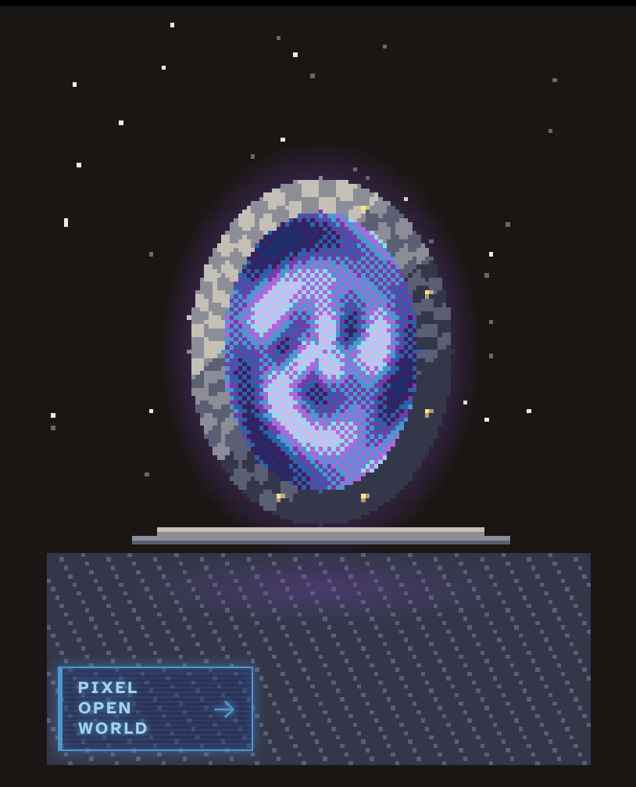
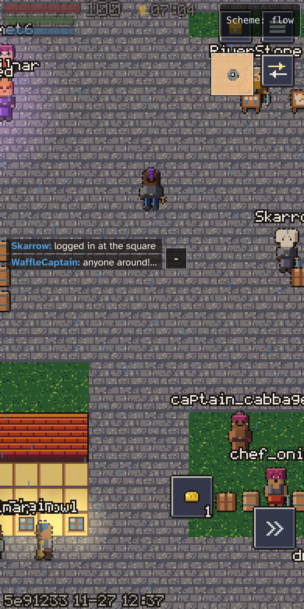
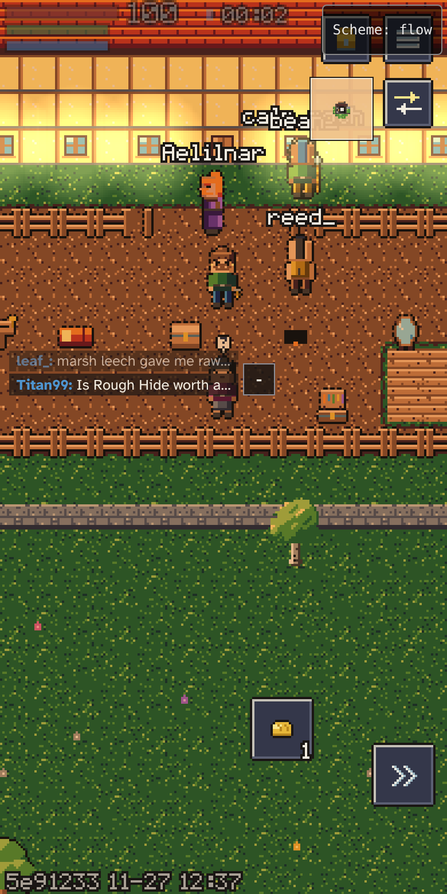
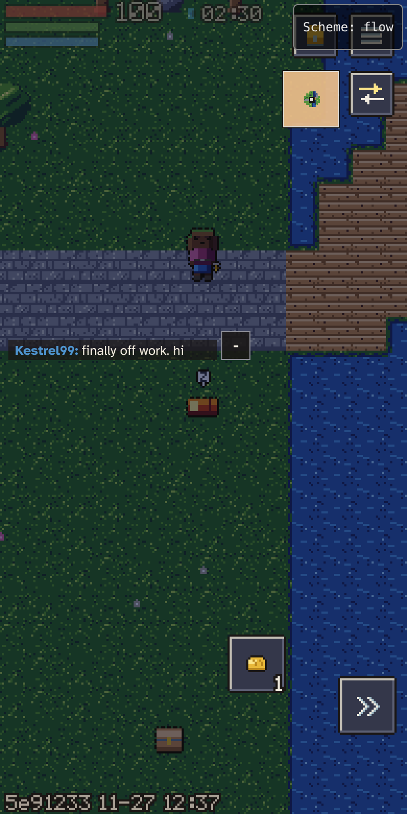
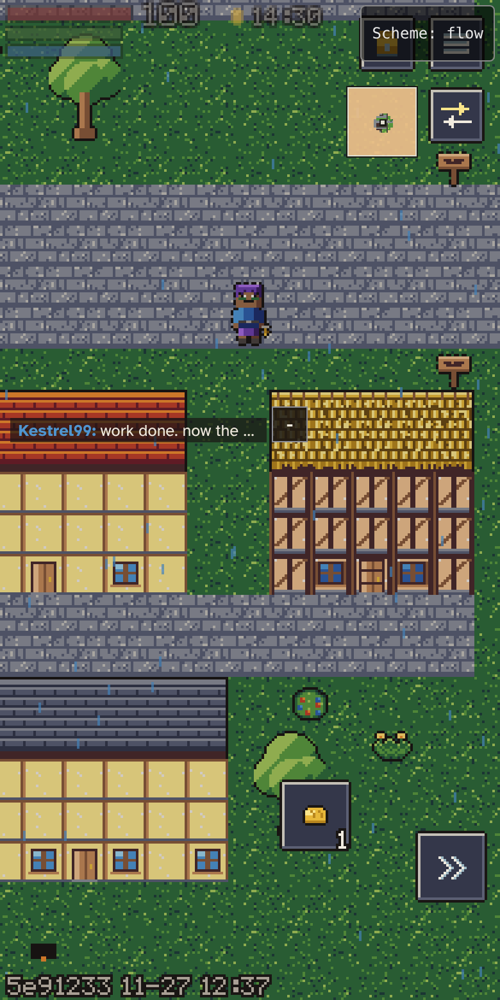

<p align="center">
  
</p>

<h1 align="center">Pixel Open World</h1>

<p align="center">
  <b>A pixel RPG that pretends to be an MMO.</b><br>
  Mobile first, runs in the browser, plays offline. You become whatever you decide to be.
</p>

<p align="center">
  <a href="https://github.com/acbalaga/pixelopenworld/actions/workflows/ci.yml"></a>
  
  
  
</p>

---

You log into a world that feels like a living online game, full of other "players" with their own lives. They log in and out on their own schedules, gather in the square, argue in chat, and wander off to work the fields. None of them are real, and nobody tells you what the world is. You find out, or you don't.

<table>
  <tr>
    <td align="center" width="25%"></td>
    <td align="center" width="25%"></td>
    <td align="center" width="25%"></td>
    <td align="center" width="25%"></td>
  </tr>
  <tr>
    <td align="center"><sub>Hearthford's square fills up by morning</sub></td>
    <td align="center"><sub>Travelers keep their own hours</sub></td>
    <td align="center"><sub>Dawnmeadow by night</sub></td>
    <td align="center"><sub>Weather moves whether you watch or not</sub></td>
  </tr>
</table>

<p align="center"><sub>Captured from the current development build, phone portrait.</sub></p>

## What makes it different

- **Become, don't pick.** No classes, no levels. Skills wake up the first time you use them and grow by use. A cook, a cartographer and a duelist are all complete lives.
- **A world that lives without you.** 240 simulated Travelers keep schedules, form parties and guilds, trade on a market, duel in the Pit and send you mail.
- **Found, not told.** The world has a hidden layer. The game never explains it.
- **One thumb, any clock.** Portrait-first touch controls. A three minute session and a three hour session both move you forward.
- **Everything generated from this repo.** Every sprite, tile, tune and sound effect is built from data in `src/content/`. No asset packs.

> [!WARNING]
> **Spoilers.** This repository contains the whole design, including the hidden layer the game is built around. `docs/design/08-lore-SPOILERS.md` and `docs/tickets/M10-hidden-layer.md` give the mystery away. Other design docs, content data and tests can hint at it too. If you want to play the game the way it is meant to be played, play first and read later.

## Status

| Milestone | What it delivers                                                                      | State       |
| --------- | ------------------------------------------------------------------------------------- | ----------- |
| M0 to M2  | Engine, first playable slice, save security                                           | Done        |
| M3        | Core RPG: skills, gathering, crafting, combat                                         | Done        |
| M4        | World tech and the first region, Dawnmeadow                                           | Done        |
| M5        | The simulated MMO crowd                                                               | In progress |
| M6 to M12 | Life systems, automation, seven more regions, the hidden layer, the frontier, release | Planned     |

The full roadmap is in [docs/tickets/](docs/tickets/README.md).

## Give feedback

Input is welcome, through issues and discussions rather than code.

| You have                     | Open                                                                                                      |
| ---------------------------- | --------------------------------------------------------------------------------------------------------- |
| A bug                        | [Bug report](../../issues/new?template=bug_report.yml)                                                    |
| Notes from a play session    | [Playtest note](../../issues/new?template=playtest_feedback.yml)                                          |
| An idea or a design critique | [Design idea](../../issues/new?template=design_idea.yml), or a thread in [Discussions](../../discussions) |

Code pull requests are not accepted for now. [CONTRIBUTING.md](CONTRIBUTING.md) explains why and what makes feedback most useful.

## Run it locally

Needs Node 22 (see `.nvmrc`).

```bash
npm ci
npm run dev
```

`npm run verify` runs lint, typecheck, unit tests, the build and the release checks. `npm run e2e` runs the Playwright smoke tests.

## How it is built

The game is built ticket by ticket from a fixed plan in `docs/`. Most implementation is done by AI coding agents working one ticket per pull request under the rules in [CLAUDE.md](CLAUDE.md). The owner sets direction, playtests at each gate, and approves every merge.

| If you are               | Read                                                                                |
| ------------------------ | ----------------------------------------------------------------------------------- |
| Curious about the game   | [docs/MASTER_PLAN.md](docs/MASTER_PLAN.md)                                          |
| Curious about the design | [docs/design/](docs/design/) (`08-lore-SPOILERS.md` spoils the whole game)          |
| Curious about the tech   | [docs/tech/](docs/tech/)                                                            |
| An implementing agent    | [CLAUDE.md](CLAUDE.md), then your ticket in [docs/tickets/](docs/tickets/README.md) |

<details>
<summary><b>Fixed decisions</b></summary>

- Portrait-first, one-thumb play. Landscape and desktop supported.
- Top-down real-time action combat.
- Single-player with a simulated MMO population. No real multiplayer.
- Classless. Skills grow by use. Identity emerges from play.
- Handcrafted continent plus an endless procedural frontier.
- All art and audio generated from data in this repo. No external asset packs.
- Custom TypeScript engine on Canvas 2D. No game framework, no runtime dependencies.
- Deployed on Cloudflare (Worker with static assets). Free. No ads, no purchases, no accounts, no analytics.
- Saves are encrypted on device and integrity-checked on load. Export files are sealed. Everything is client-side. The save scheme deters casual editing; it is not meant to stop a determined programmer (see [docs/ops/security-review.md](docs/ops/security-review.md)).

</details>

## License

No license is granted. The source is published so people can read it and give feedback. All rights are reserved by the owner. You may not copy, modify, redistribute or host the code, art data or game content without written permission.
